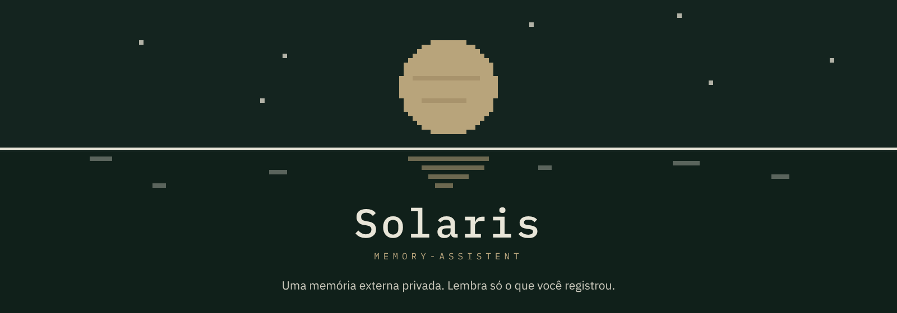
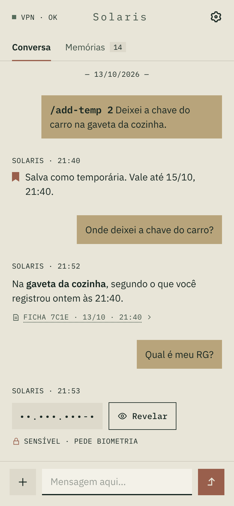
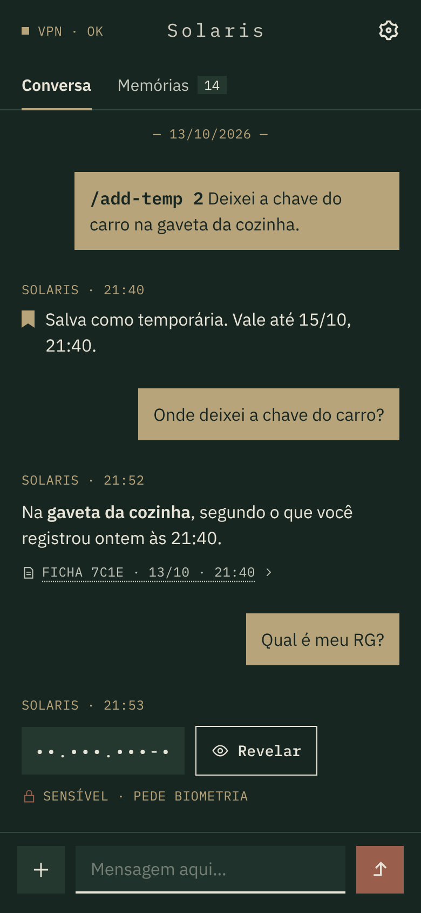
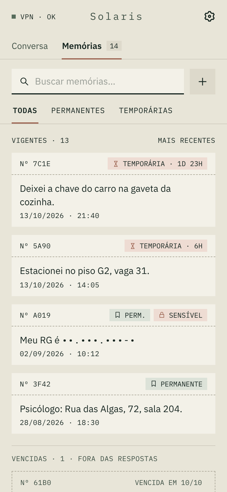
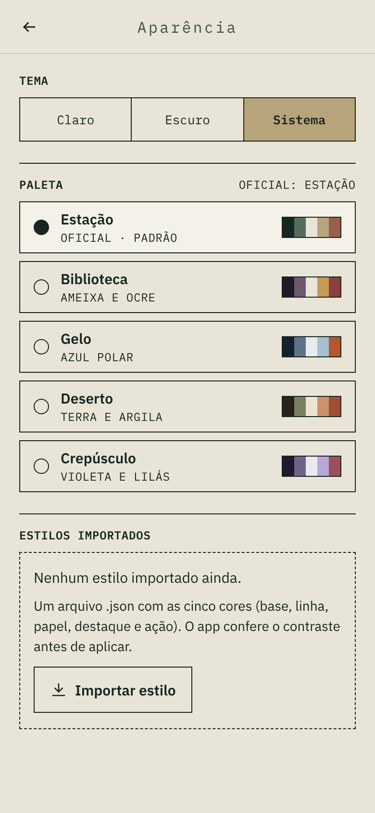

# 🪐 solaris-memory-assistent
<p align="center">
  
</p>

🇺🇸 English (this file) · 🇧🇷 [Português](README.pt-BR.md)

A private personal memory assistant: you tell it small everyday facts
through a couple of explicit commands (`/add`, `/add-temp`), and later ask
for them back in plain language. It's not a note-taking app, a task
manager, or a general-purpose assistant — it only remembers what you
explicitly told it to, and every answer always shows the exact record it
came from, never a guess.

## 🖼️ Screenshots

<p align="center">
  
  
  
  
</p>

## 🌊 Why "Solaris"?

The name comes from Tarkovsky's 1972 film *Solaris*, where a sentient ocean
reconstructs fragments of memory — not faithfully, but by recreating what
it finds. This project inverts that idea on purpose: every answer here
traces back to something you actually wrote down, never something invented.

## 🧩 What's here

- **`backend/`** — Spring Boot API: stores memories (permanent or
  temporary), answers questions about them by exact text match first, and
  falls back to semantic search (via a local Ollama embedding model) when
  nothing matches exactly. Single-user login, content encrypted at rest.
- **`frontend/`** — a Compose Multiplatform app (same code, runs on Android
  and Desktop): chat, a memories list, and settings (theme, server,
  login).
- **`deploy/`** — Docker Compose stack to put it all on a small cloud VM,
  reachable only through a WireGuard VPN tunnel. See
  [`deploy/README.md`](deploy/README.md) for the step-by-step.

## 🚀 Running locally

```bash
docker compose up -d                 # Postgres (pgvector) on localhost:5434
cd backend
mvn spring-boot:run
```

```bash
cd frontend
./gradlew :composeApp:run            # desktop app
./gradlew :composeApp:assembleDebug  # debug APK
```

Backend tests: `cd backend && mvn test`.

## 🛠️ Not done yet

- Real pixel-art font and background dithering (currently approximated).
- Automated/scheduled encrypted backups (`deploy/backup.sh` exists, isn't
  scheduled yet).
